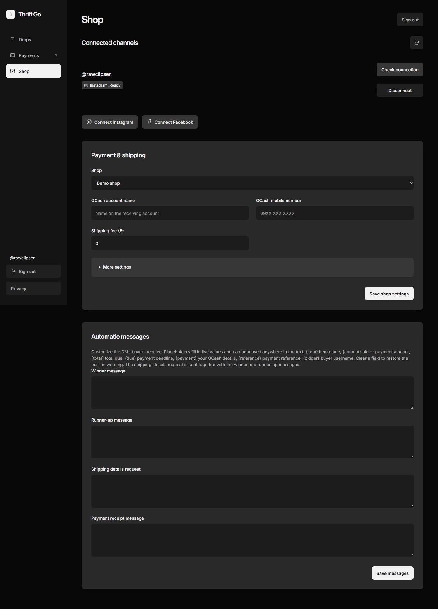
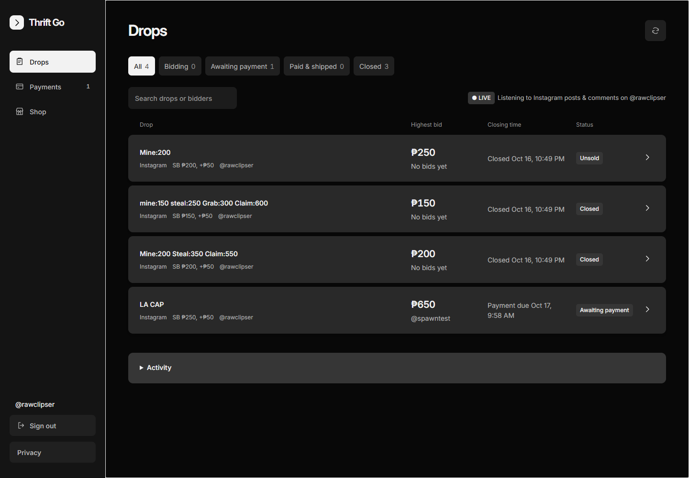

# Thrift Go

A self-hosted sales console that turns **Instagram post comments into a complete auction-to-delivery pipeline**. Built for a live thrift seller whose sales happen in the comment section: buyers comment to bid, the engine tracks the auction, and every winner is walked through payment and shipping through Instagram direct messages.

> **Notice** — this repository is a portfolio/reference release. All rights reserved (see [LICENSE](LICENSE)). It ships **without credentials, tokens, customer records, or deployment configuration**, so it cannot be run against live accounts as-is. Running it requires your own Meta app, an Instagram professional account, and your own hosting.



## What it does

- **Bids from comments.** The seller's caption carries the price ladder (`Mine: 200 / Steal: 350 / Claim: 550`). Creating a drop from a selected post parses that ladder, and every qualifying comment on that post becomes a bid.
- **Open rungs, one lock.** `mine`, `steal`, and `grab` are open ascending bids — the drop stays live and later bids must beat the standing price. Only `claim` locks the sale (at the claim price) and hands off to payment. Once a numeric bid passes the claim rung, claiming is no longer offered.
- **Messages designed around platform limits.** Instagram allows **one private reply per comment** and **text or one image per message — never both**. Thrift Go composes the winner/runner-up payment DM *and* the shipping-details request into that single guaranteed private reply, then sends the payment QR as a follow-up image DM. If Instagram's 24-hour window blocks the follow-up, it is marked "waiting for buyer" and **auto-releases the moment the buyer replies**.
- **Editable buyer messages.** Each shop can rewrite the winner, runner-up, shipping-request, and receipt templates from the console (live `{item} {amount} {total} {due} {payment} {reference} {bidder}` placeholders). An empty field restores the built-in wording.
- **Payment review, not payment promises.** A buyer's "Paid, ref 1234" is treated as a *claim for review*: the seller confirms the exact buyer and amount before the sale is recorded as paid. Unpaid winners forfeit to a different eligible runner-up at their own bid.
- **Fulfillment + inbox.** Shipping details, tracking numbers, and buyer messages live next to the drop.
- **Demo mode.** Every flow can be rehearsed on demo drops that never touch a live post and never send a real message.



## Engineering notes

- **Zero dependencies.** The server is plain Node.js (`http`, `fetch`); the console is a single-page vanilla JS app; state is file-backed JSON with atomic writes.
- **Webhook integrity.** Comment and messaging events are HMAC-verified against app secrets before anything is recorded.
- **Confirmed-delivery outbox.** Every send carries a persisted reservation; a message is never blindly re-attempted after an unknown network outcome — the seller reviews interrupted notifications.
- **Tenant isolation.** Shops, settings, drops, messages, and uploads are scoped per connected account, and cross-tenant access is covered by tests.
- **Loopback-only operator access.** Operator conveniences apply only to genuine local requests; proxied visitors always go through the shop login flow.
- **Tests.** `npm test` runs 46 focused tests over the bid engine, caption parser, message composition, outbox, security boundaries, and OAuth/webhook plumbing — with temporary stores and mocked Graph calls, never live accounts.

## Stack

| Piece | Choice |
| --- | --- |
| Runtime | Node.js >= 20, no npm dependencies |
| Console | Single-page vanilla JS + CSS |
| State | JSON files under `data/` + an encrypted token store kept outside the repo |
| Platform | Meta Graph API — Instagram Login (comments, messaging, webhooks) |
| Hosting | Any small host + a named Cloudflare tunnel (`cloudflared.example.yml` included) |

## Repository layout

```
src/      server, bid engine, caption parser, Meta clients, token store
public/   seller console (single page)
test/     node:test suites (46 tests)
ops/      launcher / keep-alive scripts
docs/     screenshots
```

## Running it yourself

1. Create a Meta app with Instagram Login and webhook access for a professional account; note the app id/secret and choose a webhook verify token.
2. Copy `.env.example` to `.env` and fill in your own values.
3. `npm start` serves `http://127.0.0.1:4331`. Expose it with your own tunnel (see `cloudflared.example.yml`) and point the app's webhook and OAuth redirect at your URL.
4. Connect your Instagram professional account in the console, save your payment details, upload your payment QR, and create a drop from one of your posts.

## License

All rights reserved. Published for portfolio review and reference only — see [LICENSE](LICENSE).
